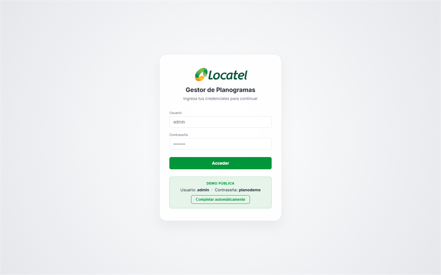
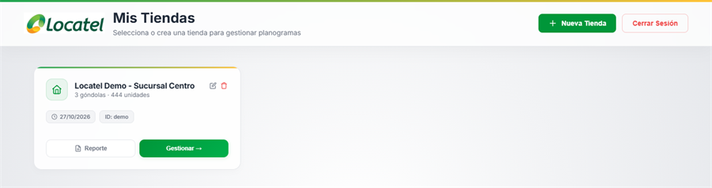
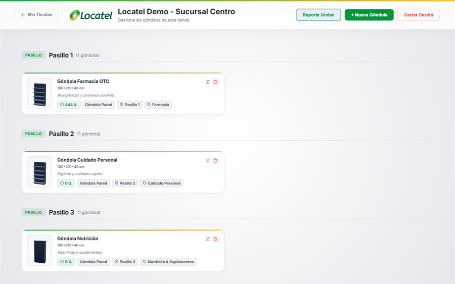
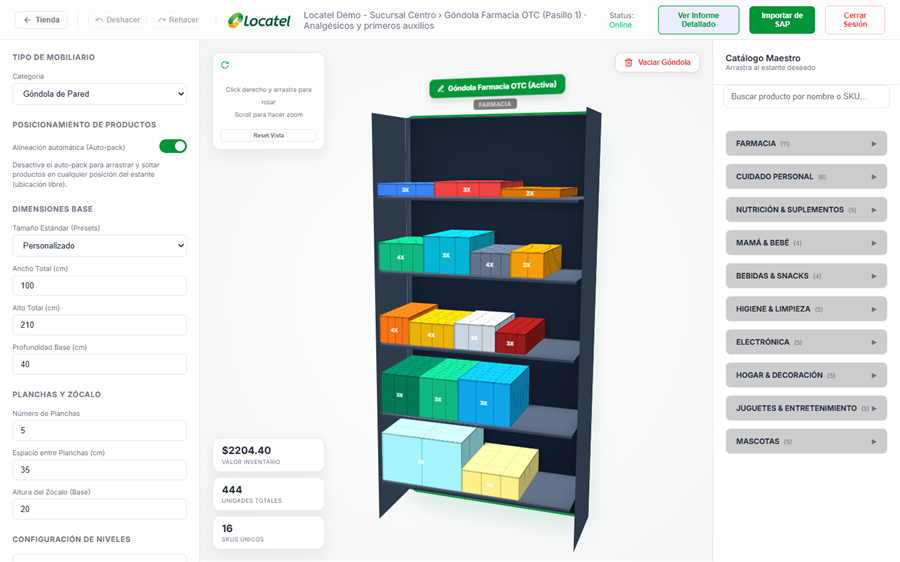

# Planogram Pro Builder — Demo

Prototipo web para la gestión operativa de espacios comerciales en retail: creación, catalogación y evaluación de góndolas a partir de información de inventario y parámetros de mobiliario. `Pasantías`

> **Demo en vivo:** [planogramademo.vercel.app](https://planogramademo.vercel.app/login.html) — usuario `admin`, contraseña `planodemo`.
>
> Este repositorio contiene el prototipo front-end, sin backend. La versión completa con Next.js, SQL Server y autenticación real está en [**planogramsystem**](https://github.com/Sneider22/planogramsystem).

---

## Capturas

| Inicio de sesión | Mis Tiendas |
| :---: | :---: |
| <a href="docs/screenshots/01-login.png"></a> | <a href="docs/screenshots/02-stores.png"></a> |
| **Góndolas por pasillo** | **Editor de góndola** |
| <a href="docs/screenshots/03-store-details.png"></a> | <a href="docs/screenshots/04-editor.png"></a> |

<sub>Datos de demostración. Haz clic en una captura para verla en tamaño completo.</sub>

---

## Funcionalidades

*   **Gestión de Tiendas:** Creación, edición y eliminación de tiendas con ID automático o personalizado.
*   **Gestión de Góndolas:** Mobiliario organizado por pasillo y categoría, con edición, duplicado y eliminación.
*   **Editor de Góndolas:** Configuración de tipo de mobiliario, dimensiones, planchas y zócalo; colocación de productos con alineación automática (auto-pack) o ubicación libre, y deshacer/rehacer.
*   **Catálogo Maestro:** 55 productos simulados en 10 categorías (farmacia, cuidado personal, nutrición, bebé, entre otras), con búsqueda por nombre o SKU.
*   **Métricas en Tiempo Real:** Valor de inventario, unidades totales y SKUs únicos por góndola.
*   **Reportes:** Exportación a PDF y Excel, por góndola y consolidados por tienda.

---

## Tecnologías

*   **HTML5, CSS3 y JavaScript** sin frameworks ni proceso de compilación.
*   **localStorage** como capa de persistencia en el navegador.
*   **jsPDF** y **jsPDF-AutoTable** para la generación de reportes PDF.
*   **SheetJS (xlsx)** para la exportación a Excel.
*   **Vercel** para el despliegue de la demo.

---

## Ejecución Local

El proyecto no requiere instalación. Basta con clonar el repositorio y abrir `index.html` en el navegador:

```bash
git clone https://github.com/Sneider22/planogramademo.git
cd planogramademo
```

Si prefieres servirlo localmente, cualquier servidor estático funciona, por ejemplo:

```bash
npx serve .
```

---

## Estructura del Proyecto

```text
/
├── index.html            # Redirige a login.html
├── login.html            # Acceso al prototipo
├── stores.html           # Listado y gestión de tiendas
├── store-details.html    # Góndolas de una tienda y reporte global
├── editor.html           # Editor de góndolas y reportes detallados
├── css/style.css         # Estilos globales e identidad visual
├── docs/screenshots/     # Capturas usadas en este README
└── js/
    ├── state.js          # AppState: estado global, persistencia y catálogo de productos
    ├── login.js          # Validación de credenciales de la demo
    ├── stores.js         # Lógica de la vista de tiendas
    ├── store-details.js  # Flujo de góndolas y reportes por tienda
    ├── editor.js         # Colocación de productos, cálculo de espacio y exportes
    ├── calculator.js     # Cálculo de unidades y validación de profundidad
    └── ui.js             # Utilidades de interfaz y manejo de vistas
```

---

## Persistencia

Toda la información se conserva en el `localStorage` del navegador, por lo que cada visitante trabaja con sus propios datos y estos no se comparten entre dispositivos.

| Clave | Contenido |
| :--- | :--- |
| `planogram_stores` | Tiendas y sus góndolas |
| `planogram_next_store_auto_id` | Siguiente ID automático de tienda |
| `planogram_store_id` / `planogram_gondola_id` | Tienda y góndola seleccionadas |
| `planogram_logged_in` | Indicador de sesión iniciada |

---

## Alcance del Prototipo

Este proyecto se enfoca en validar la experiencia de usuario y la lógica de negocio de un sistema de planogramas. No incluye servidor, autenticación real ni almacenamiento remoto; esas capacidades se implementan en la versión completa.

---

## 🔗 Proyectos Relacionados

*   [**planogramsystem**](https://github.com/Sneider22/planogramsystem): versión completa de la plataforma con Next.js 14, Prisma, SQL Server 2022, autenticación JWT y despliegue con Docker.
